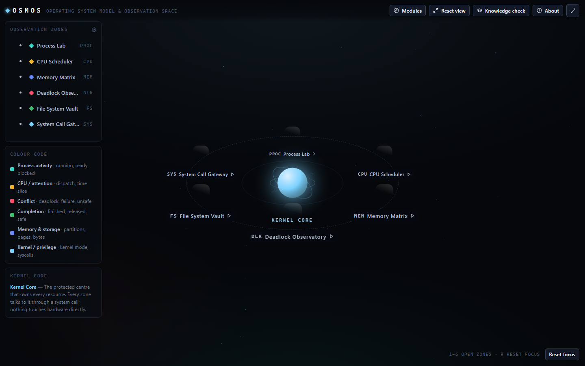
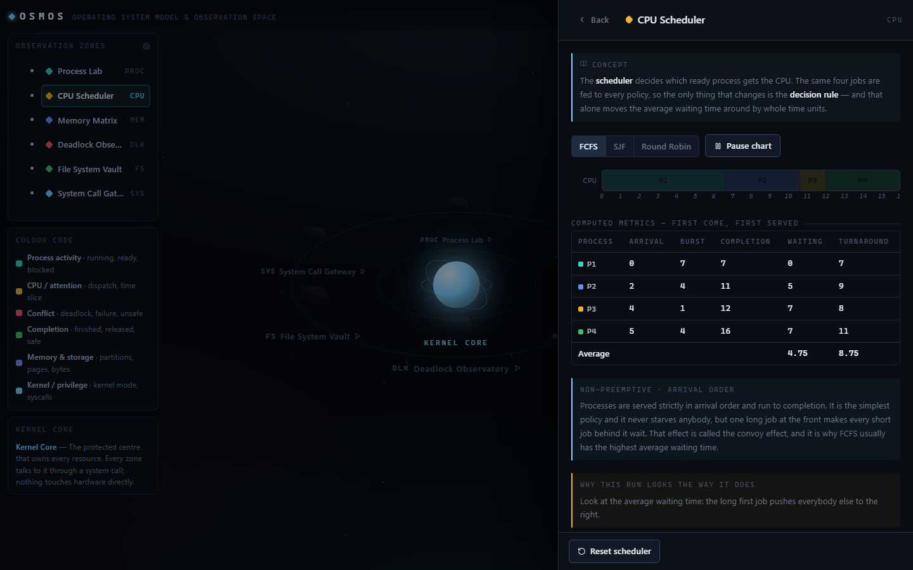
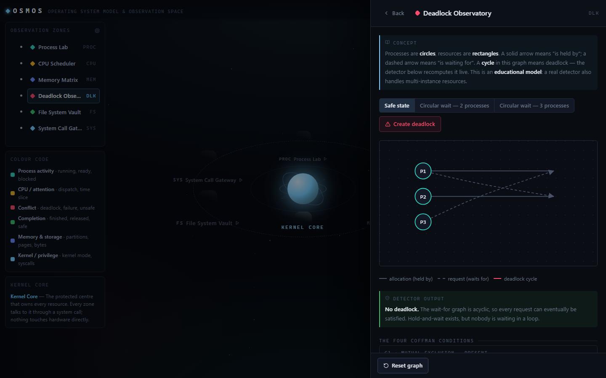
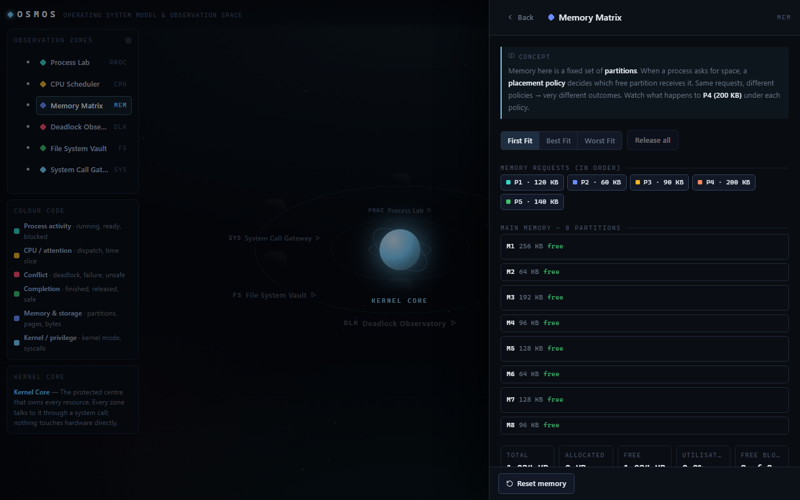
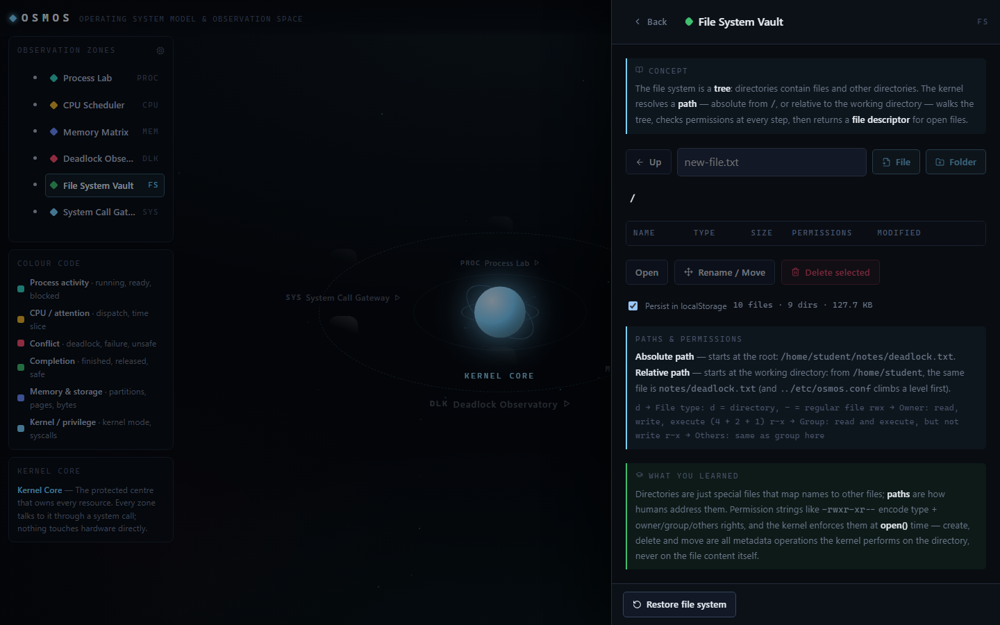
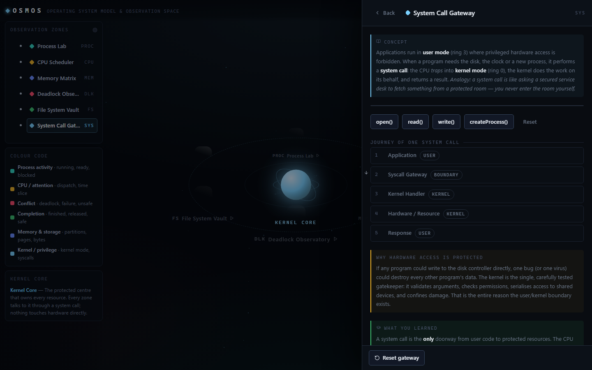

# OSMOS — An Interactive Operating-System Concept Explorer

> **Operating System Model & Observation Space** — a cinematic, browser-based exhibition that
> teaches how an operating system manages processes, CPU time, memory, resources, files and
> hardware protection. Every animation is driven by a real algorithm running in your browser —
> nothing is faked.

| Live demo | Repository |
| --- | --- |
| https://V1PU1LXRD.github.io/osmos-os-explorer/ | https://github.com/V1PU1LXRD/osmos-os-explorer |


---

## Screenshots

| Shell | CPU Scheduler | Deadlock Observatory |
| --- | --- | --- |
|  |  |  |

| Memory Matrix | File System Vault | System Call Gateway |
| --- | --- | --- |
|  |  |  |

Regenerate them at any time with `node scripts/screenshot.mjs` (desktop, tablet and phone
viewports).

---

## Features

- **Boot sequence** with realistic kernel messages and a Skip button (~3.6 s).
- **Interactive constellation** — a protected Kernel Core at the centre of a tilted orbit with
  six discoverable zones. Depth on the ellipse drives each node's scale, brightness and stacking
  order, so the map reads as 3D while staying a single layout pass of plain elements.
- **Six learning modules**, each with a concept brief, live simulation, and a "What you learned"
  summary:
  1. **Process Lab** — the five-state lifecycle (New → Ready → Running → Waiting → Terminated),
     animated tick-by-tick. Add processes, pause/resume, inspect any PCB.
  2. **CPU Scheduler** — FCFS, SJF and Round Robin with selectable quantum (1–5), an animated
     Gantt chart, and real waiting/turnaround/completion math plus a cross-policy comparison.
  3. **Memory Matrix** — fixed partitions with First/Best/Worst Fit placement, animated
     allocation and release, internal/external fragmentation statistics and an event log.
  4. **Deadlock Observatory** — resource-allocation graph (processes as circles, resources as
     rectangles), live cycle detection, the four Coffman conditions, one-click deadlock
     scenarios and recovery by terminating a process.
  5. **File System Vault** — a real, editable directory tree with breadcrumbs, create/delete/
     rename/move, UNIX permission strings, and optional localStorage persistence.
  6. **System Call Gateway** — user mode vs kernel mode, four sample syscalls animated through
     five stages (Application → Gateway → Kernel → Hardware → Response) with a live trace log.
- **Knowledge Check** — a five-question quiz based strictly on what the simulations show, with
  per-question explanations, scoring and restart.
- **About panel** — project identity, objective, stack and concepts, all sourced from one config
  file.
- **Resilience** — `prefers-reduced-motion` is honoured, every simulation has a reset button, and
  an error boundary keeps the rest of the app alive if one module throws.

## OS concepts demonstrated

| Zone | Concepts |
| --- | --- |
| Process Lab | Process lifecycle, PCB, state transitions, I/O blocking |
| CPU Scheduler | FCFS, SJF (non-preemptive), Round Robin, quantum, convoy effect, starvation, context switches |
| Memory Matrix | Fixed partitions, First/Best/Worst Fit, internal & external fragmentation |
| Deadlock Observatory | Coffman conditions, resource-allocation graph, wait-for graph, cycle detection, recovery |
| File System Vault | Hierarchical directories, absolute vs relative paths, permissions (rwx), create/delete/move |
| System Call Gateway | User mode vs kernel mode, protection rings, trap, syscall flow, file descriptors |

## Tech stack

- [React 19](https://react.dev) + [Vite 6](https://vitejs.dev)
- No WebGL: the zone map is plain positioned elements and CSS 3D transforms. A measured WebGL
  scene ran at 4fps under software rendering; the CSS version holds 60fps on the same machine and
  removes roughly 310 KB of gzipped JavaScript.
- [Framer Motion](https://www.framer.com/motion/) for 2D UI transitions
- [Lucide React](https://lucide.dev) for icons
- Plain modern CSS with design tokens (no UI framework)
- GitHub Actions for GitHub Pages deployment

No backend, no database, no authentication, no API keys, no paid services. All demo data is
deterministic and stored in `src/data/`.

## Installation

Prerequisites: **Node.js 18+** and npm.

```bash
git clone https://github.com/V1PU1LXRD/osmos-os-explorer.git
cd osmos-os-explorer
npm install
```

## Run locally

```bash
npm run dev
```

Open the printed URL (default `http://localhost:5173`).

## Build

```bash
npm run dev              # development server at http://localhost:5173
npm run verify           # algorithm checks (no browser needed)
npm run verify:responsive # static CSS / breakpoint audit (no browser needed)
npm run build            # runs verify, then outputs a production bundle to dist/
npm run verify:layout    # real-browser layout audit — run after build
npm run verify:all       # everything above, in the order that makes them valid
npm run preview          # serve dist/ locally at http://localhost:4173
npm run perf             # load timings, transfer weight, frame pacing
npm run screenshots      # regenerate docs/screenshots/
```

### Verifying the algorithms

Every simulation in this project is driven by a pure function in `src/utils/`. Those functions
are not decorative: `scripts/verify-algorithms.mjs` checks them against hand-computed
expectations (a known FCFS timeline, the exact waiting time of a three-process job set,
fragmentation arithmetic, cycle detection on known graphs, the process state machine, and the
immutability of file-system edits). It needs no test framework and no browser.

```bash
npm run verify
# … 69/69 checks passed.
```

`npm run build` runs it first, so a broken algorithm cannot reach `dist/`.

### Verifying the interface

Two more audits cover the parts a unit test cannot see. Both drive headless Chromium against a
real production build, so run `npm run build` first.

```bash
npm run verify:responsive   # 36/36 static CSS checks, no browser needed
npm run verify:layout       # 281/281 real-browser checks across 10 device profiles
npm run perf                # FCP, transfer weight, long tasks, frame pacing
```

`verify-layout.mjs` is the important one. It opens every module on an iPhone SE through a
1920px desktop and fails on horizontal overflow, sub-44px tap targets, panels that render
off-screen, and console errors. Two real bugs came out of it: a CSS ordering error left the
rail's drawer toggle visible on desktop, and the File System Vault's checkbox was a 13px-wide
strip on touch. Neither was visible by eye.

`measure-perf.mjs` is the script behind the no-WebGL decision. `diagnose-perf.mjs` re-attributes
frame cost to individual constellation layers when you need to know which one regressed.

## Deploy to GitHub Pages (recommended, free)

The repository ships with `.github/workflows/deploy.yml`, which builds and publishes the site
on every push to `main`.

1. **Create a GitHub repository** named exactly `osmos-os-explorer` (or your own name — see
   step 5).
2. **Push the code to `main`:**
   ```bash
   git init
   git add .
   git commit -m "OSMOS: initial release"
   git branch -M main
   git remote add origin https://github.com/V1PU1LXRD/osmos-os-explorer.git
   git push -u origin main
   ```
3. **Enable Pages:** repository **Settings → Pages**.
4. **Choose the source:** under *Build and deployment → Source*, select **GitHub Actions**.
   The next push (or a manual *Run workflow* on the Actions tab) will build and deploy.
5. **If your repository name is different** from `osmos-os-explorer`, update **one line** —
   `basePath` in `src/config/projectConfig.js` — to `"/<your-repo-name>/"`. `vite.config.js`
   reads it from there, so asset URLs stay correct.
6. Your site appears at `https://V1PU1LXRD.github.io/osmos-os-explorer/`.

### Alternative free hosting (Netlify / Vercel)

Both work with zero configuration: import the repository, set the build command to
`npm run build` and the publish directory to `dist`. With Vercel/Netlify you can leave
`basePath` as `/` (or remove the override in `vite.config.js`). GitHub Pages remains the
recommended method for this project.

## Project structure

```
osmos-os-explorer/
├── .github/workflows/deploy.yml     # build + publish to GitHub Pages
├── public/favicon.svg
├── index.html
├── package.json
├── vite.config.js                   # base path + chunking for fast loads
├── scripts/
│   ├── verify-algorithms.mjs        # hand-computed checks for src/utils/*
│   ├── verify-responsive.mjs        # static breakpoint / safe-area / touch audit
│   ├── verify-layout.mjs            # real-browser layout audit, 10 device profiles
│   ├── measure-perf.mjs             # load timings, transfer weight, frame pacing
│   ├── diagnose-perf.mjs            # attributes frame cost to constellation layers
│   ├── screenshot.mjs               # regenerates docs/screenshots/
│   ├── diagnose-css.mjs             # attributes frame cost to CSS animations
│   └── probe.mjs                    # ad-hoc console/network probe at a URL
├── docs/screenshots/                # generated captures used in the README
└── src/
    ├── main.jsx                     # entry: mounts React, imports styles
    ├── App.jsx                      # shell: boot, scene, rail, panel, overlays
    ├── config/
    │   └── projectConfig.js         # ✏️ NAME / COLLEGE / REPO / base path — edit me
    ├── data/                        # deterministic demo data (no fetching)
    │   ├── zones.js                 #   six zones + kernel core + colour semantics
    │   ├── processes.js             #   Process Lab dataset & state definitions
    │   ├── schedulingData.js        #   fixed scheduling workload + algorithm copy
    │   ├── memoryData.js            #   partitions & requests
    │   ├── deadlockScenarios.js     #   safe / 2-cycle / 3-cycle scenarios
    │   ├── fileSystemTree.js        #   initial virtual directory tree
    │   ├── systemCalls.js           #   four sample syscalls, five stages each
    │   └── quiz.js                  #   five knowledge-check questions
    ├── utils/                       # pure algorithms, no React
    │   ├── scheduling.js            #   FCFS / SJF / Round Robin
    │   ├── processLifecycle.js      #   five-state tick machine
    │   ├── memoryAllocation.js      #   first/best/worst fit + fragmentation stats
    │   ├── deadlockDetection.js     #   wait-for graph + DFS cycle detection
    │   ├── fileSystem.js            #   immutable tree operations
    │   ├── random.js                #   seeded PRNG for deterministic scenes
    │   ├── format.js                #   small formatting helpers
    │   ├── useReducedMotion.js      #   prefers-reduced-motion hook
    │   └── useViewport.js           #   phone / tablet / desktop breakpoint hook
    ├── scene/
    │   └── Constellation.jsx        #   the zone map: kernel core + six orbit nodes
    ├── components/                  # UI chrome (boot, top bar, rail, panels…)
    └── modules/                     # the six learning modules
        ├── ProcessLab/
        ├── CpuScheduler/
        ├── MemoryMatrix/
        ├── DeadlockObservatory/
        ├── FileSystemVault/
        ├── SystemCallGateway/
        └── shared/ModuleBits.jsx    #   summary / learned / spinner blocks
```

## The algorithms, explained

### FCFS — First Come, First Served
Processes are dispatched in arrival order and run to completion. Implementation: sort by
(arrival, index), keep a running clock, insert an *idle* block when the next process has not
arrived yet. Simple and starvation-free, but a long first job delays everyone behind it (the
**convoy effect**), which usually gives it the highest average waiting time of the three.

### SJF — Shortest Job First (non-preemptive)
Whenever the CPU frees up, pick the *arrived* process with the smallest burst. Implementation:
at each scheduling point, filter the not-yet-run processes to those that have arrived; if none
have, advance the clock to the next arrival; otherwise pick minimum burst. Provably optimal for
average waiting time — but only when burst times are known, and a stream of short jobs can
starve a long one.

### Round Robin
Each process runs for at most one **quantum**. Implementation: a FIFO ready queue; jobs arriving
during a slice enqueue *before* the preempted process re-joins; the head of the queue runs for
min(quantum, remaining). Small quanta → responsive but many context switches; large quanta →
degenerates toward FCFS. Waiting time = turnaround − burst in all three policies.

### First Fit
Scan partitions from the start; allocate the **first** free partition large enough. Fast, and it
tends to preserve the big end-of-memory holes.

### Best Fit
Allocate the **smallest** free partition that still fits. Minimises waste *per allocation*, but
the leftovers are tiny slivers that rarely satisfy later requests — fragmentation accumulates.

### Worst Fit
Allocate the **largest** free partition, hoping the remainder stays usable. In practice it
consumes the big holes first and fails earliest for large processes.

### Deadlock cycle detection
The module converts the resource-allocation graph into a **wait-for graph** (P waits for Q iff P
requests a resource that Q holds) and runs a depth-first search that records every cycle
(rotations of the same loop are de-duplicated). A cycle in a single-instance wait-for graph is
exactly a deadlock. **Recovery** terminates one involved process, releasing its resources and
cancelling its requests — the cycle disappears. *This is an educational model; production
detectors also handle multi-instance resources (e.g. the avoidance algorithm).*

### The process lifecycle tick
Each animation frame of the Process Lab is one call to a pure `tick(processes)` that returns new
objects. Per tick it admits everything in *New*, counts down I/O for anything *Waiting*,
dispatches at most one *Ready* process onto the CPU (lowest priority number first), then charges
the runner one unit of burst. A runner blocks for I/O exactly once per lifetime, around the
halfway point of its burst, and never on its final unit. A process whose I/O completes this tick
is not eligible for dispatch until the next one, so the *waiting → ready* edge is always visible
rather than being skipped in a single frame.

## Limitations

- Single-core CPU model; SMP/multicore scheduling is out of scope.
- SJF uses the real burst times (a real OS can only estimate them).
- Memory model is fixed partitions only — paging/segmentation are explained, not simulated.
- Deadlock detection assumes one instance per resource.
- The file system is a browser-side tree; it does not model inodes, journaling or blocks.
- The zone map's depth is solved with trigonometry on a squashed ellipse, not real 3D — it is a
  deliberate trade for one layout pass instead of a GPU canvas.

## Future improvements

- Paging and page-replacement algorithms (FIFO, LRU, Clock).
- Preemptive SJF (SRTF) and priority scheduling with aging.
- Multi-instance deadlock model with Banker's algorithm.
- Multicore Gantt lanes in the scheduler.
- Save/restore of every module's state to localStorage.
- Optional narration and guided tour mode for classroom demos.

## Credits

Built by **Vipul Kanhere** as a second-year B.Tech (AI & ML) mini-project for the Operating Systems
course, *Alard University, Hinjewadi, Pune*.

Thanks to the open-source community behind React, Framer Motion and Lucide. OS concepts follow
the standard treatment in Silberschatz, Galvin & Gagne, *Operating System Concepts*.

## License

Released under the [MIT License](LICENSE). You are free to use, modify and distribute this
project with attribution.
